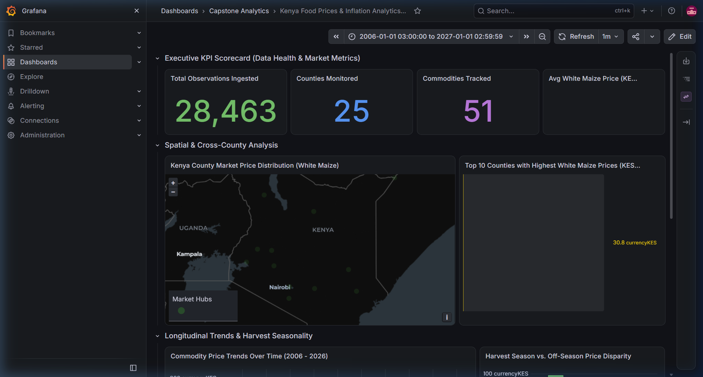
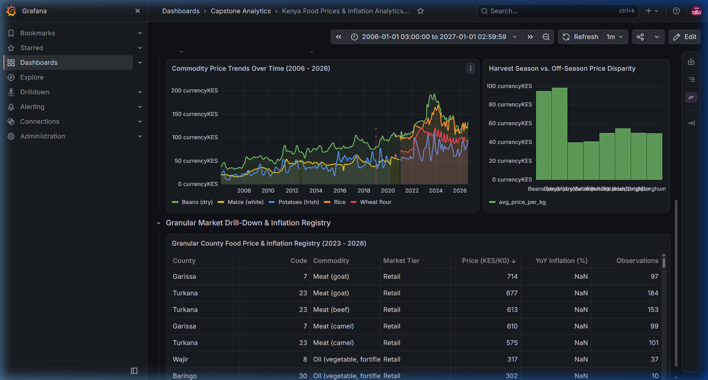

# Kenya Food Prices & Inflation Trends Data Platform
[](https://www.postgresql.org/)
[](https://airflow.apache.org/)
[](https://grafana.com/)
[](https://www.python.org/)
[](docs/milestone_6_governance_report.md)

A production-grade, end-to-end Data Engineering platform built to ingest, clean, model, and analyze retail and wholesale food prices across Kenya's 47 counties, detect regional inflation patterns, and generate actionable insights for policymakers, farmers, and consumers.

Engineered by **James Kinyua** as an enterprise-grade cloud analytical platform.

---

## Live Dashboard Showcase

The platform serves an interactive, real-time visual analytics suite powered by Grafana and backed by our PostgreSQL Kimball Star Schema:

### Executive KPI Scorecard & Kenya Market Distribution Map


### 20-Year Commodity Price Trends, Seasonality Disparity & Market Registry


---

## 1. Project Background & Economic Context

* **Food Inflation Dominance**: In Kenya, food and non-alcoholic beverages constitute over **32.9%** of the Consumer Price Index (CPI) basket. Volatility in staple commodities (dry maize, beans, potatoes, cooking oil, milk) directly drives headline national inflation.
* **County-Level Disparities**: Kenya's 47 counties experience divergent agricultural realities. Agricultural surplus zones (Trans-Nzoia, Uasin Gishu, Nyandarua) contrast with Arid and Semi-Arid Lands (ASAL counties such as Turkana, Mandera, Marsabit, Garissa) that suffer structural supply deficits, severe drought cycles, and high transport margins.
* **The Platform Objective**: Automate the collection of official ground-surveyed market records, normalize inconsistent packaging units (e.g., 90kg bags vs. per-kg retail), model data into an analytical Star Schema, and visualize inflation heatmaps and commodity price trends.

---

## 2. System Architecture (Medallion Pattern)

The platform follows a modern **Medallion Architecture (Bronze $\rightarrow$ Silver $\rightarrow$ Gold)** running natively on a Linux VPS:

```
                      ┌────────────────────────────────────────┐
                      │          External Data Source          │
                      │  WFP / HDX Kenya Food Prices (CSV/API) │
                      │  (Collected by KNBS, MoA, and NDMA)    │
                      └───────────────────┬────────────────────┘
                                          │
                                          ▼
                      ┌────────────────────────────────────────┐
                      │       Orchestration Layer              │
                      │         Apache Airflow                 │
                      │  (Scheduled Ingestion, SLAs, Lineage)  │
                      └───────────────────┬────────────────────┘
                                          │
                                          ▼
  ┌───────────────────────────────────────────────────────────────────────────────┐
  │                           PostgreSQL Database Engine                          │
  │                                                                               │
  │  ┌───────────────────────┐   SQL Transform   ┌─────────────────────────────┐  │
  │  │    staging Schema     │──────────────────▶│      analytics Schema       │  │
  │  │ (Raw, Immutable Feed) │    (In-Engine)    │     (Kimball Star Schema)   │  │
  │  │ raw_wfp_food_prices   │                   │  dim_date, dim_commodity,   │  │
  │  └───────────────────────┘                   │  dim_location, fact_prices  │  │
  │              │                               └──────────────┬──────────────┘  │
  │              │ Audit & Lineage Logs                         │                 │
  │              ▼                                              ▼                 │
  │  ┌───────────────────────┐                   ┌─────────────────────────────┐  │
  │  │   governance Schema   │                   │      Serving Layer          │  │
  │  │  pipeline_audit_log   │                   │         Grafana             │  │
  │  │  data_quality_log     │                   │  (Geomaps, Trends, Gauges)  │  │
  │  │  source_metadata_cat. │                   │  Live Port: 3000            │  │
  │  └───────────────────────┘                   └─────────────────────────────┘  │
  └───────────────────────────────────────────────────────────────────────────────┘
```

---

## 3. Conceptual Data Model (Kimball Star Schema)

The analytical warehouse (`analytics` schema) implements a Kimball Star Schema organized around the 4 fundamental pillars of economic inquiry:

```
                            ┌────────────────────────┐
                            │      1. DIM_DATE       │
                            │        (When?)         │
                            │  Day, Month, Year,     │
                            │  Harvest Season Flag   │
                            └───────────┬────────────┘
                                        │
                                        ▼
┌────────────────────────┐   ┌──────────────────────┐   ┌────────────────────────┐
│   2. DIM_COMMODITY     │   │ 4. FACT_FOOD_PRICES  │   │    3. DIM_LOCATION     │
│        (What?)         │   │     (How Much?)      │   │        (Where?)        │
│  Commodity Name,       │◀──│  Raw Price,          │──▶│  Market Name, County,  │
│  Category (Cereals),   │   │  Normalized Price/KG,│   │  County Code (001-047),│
│  CPI Basket Indicator  │   │  MoM Change %,       │   │  Latitude & Longitude  │
│  51 Distinct Items     │   │  YoY Inflation %,    │   │  226 Market Hubs       │
└────────────────────────┘   │  Wholesale/Retail    │   └────────────────────────┘
                             │  28,463 Records      │
                             └──────────────────────┘
```

---

## 4. Automated Airflow Pipeline Orchestration

The pipeline is orchestrated via Apache Airflow running on schedule `0 6 15 * *` (06:00 AM on the 15th of each month, matching the KNBS survey publication cadence):

1. **`check_source_health`**: Pings the HDX/KNBS remote data endpoint to verify server availability before triggering ingestion. Includes transient network failure retry handling.
2. **`extract_raw_data`**: Atomically downloads the raw CSV with MD5 cryptographic hash integrity verification (`4bff3219a5743fa8110d08ba15af3010`).
3. **`transform_clean_normalise`**: Executes Pandas cleaning engine:
   - Converts packaging units (90kg bags, 50kg bags, 64kg bags) to standard per-KG price.
   - Imputes missing coordinates for `Hola (Tana River)`.
   - Maps historical administrative sub-districts (Moyale, Ijara, Meru North/South) to modern 47 constitutional county codes.
   - Calculates Month-over-Month (MoM %) and Year-over-Year (YoY %) price changes.
4. **`load_postgres_warehouse`**: Idempotently populates staging tables and the Star Schema dimensional tables via `ON CONFLICT DO UPDATE`.
5. **`validate_data_quality_and_audit`**: Executes 6 deterministic data quality assertions, logs pipeline execution lineage, and records results into the `governance` schema.

---

## 5. Automated Data Quality Scorecard (Milestone 6)

Every pipeline execution validates 6 automated quality assertions against PostgreSQL:

| Check Name | Target Table | Assertion Rule | Status | Failed Rows |
| :--- | :--- | :--- | :---: | :---: |
| **`check_reconciliation_parity`** | `fact_food_prices` | `COUNT(staging) == COUNT(fact)` (28,463 rows) | **PASSED** | 0 |
| **`check_positive_prices`** | `fact_food_prices` | `normalized_price_per_kg > 0 AND raw_price > 0` | **PASSED** | 0 |
| **`check_no_null_foreign_keys`** | `fact_food_prices` | `date_id`, `commodity_id`, `location_id` are NOT NULL | **PASSED** | 0 |
| **`check_geographic_boundaries`**| `dim_location` | Latitude (-5.0° to 5.5°) & Longitude (33.5° to 42.5°) | **PASSED** | 0 |
| **`check_official_county_codes`** | `dim_location` | County Code between 1 and 47 | **PASSED** | 0 |
| **`check_temporal_validity`** | `dim_date` | Year between 2006 and 2026 | **PASSED** | 0 |

---

## 6. System Architecture & Component Mapping

| Architectural Component | Technical Scope & Implementation | Core Deliverable | Operational Status |
| :--- | :--- | :--- | :---: |
| **Data Modeling** | Kimball Star Schema OLAP design with 4 pillars | [`sql/02_analytics/create_star_schema.sql`](sql/02_analytics/create_star_schema.sql) | **Production Active** |
| **Batch Ingestion** | Atomic `.tmp` writes with MD5 hash validation | [`scripts/extract_wfp_food_prices.py`](scripts/extract_wfp_food_prices.py) | **Production Active** |
| **Data Cleaning** | Normalization (per-kg), GPS & administrative imputation | [`scripts/transform_clean_food_prices.py`](scripts/transform_clean_food_prices.py) | **Production Active** |
| **Data Warehouse** | Staging and Fact/Dimension loading with idempotency | [`scripts/load_to_postgres.py`](scripts/load_to_postgres.py) | **Production Active** |
| **Orchestration** | Apache Airflow 5-task DAG with automated retry policy | [`dags/kenya_food_prices_dag.py`](dags/kenya_food_prices_dag.py) | **Production Active** |
| **Governance & Quality** | 6-rule assertion matrix, source catalog, lineage tracing | [`scripts/run_data_quality_checks.py`](scripts/run_data_quality_checks.py) | **Production Active** |
| **Visual Analytics** | Declarative Grafana provisioning & interactive dashboards | [`grafana/kenya_food_inflation_dashboard.json`](grafana/kenya_food_inflation_dashboard.json) | **Production Active** |
| **Audit & Reporting** | Automated data quality verification & audit reports | [`docs/milestone_6_governance_report.md`](docs/milestone_6_governance_report.md) | **Production Active** |

---

## 7. Setup & Reproduction Guide

### Prerequisites
- Python 3.10+
- PostgreSQL 14+
- Apache Airflow 2.8+ / 3.x
- Grafana 10+ / 13.x

### Quickstart Installation
1. Clone the repository:
   ```bash
   git clone https://github.com/jimkinyua/kenya-food-market-analytics.git
   cd kenya-food-market-analytics
   ```

2. Create and activate a Python virtual environment:
   ```bash
   python3 -m venv venv
   source venv/bin/activate  # On Windows: .\venv\Scripts\activate
   pip install -r requirements.txt
   ```

3. Configure environment variables:
   ```bash
   cp .env.example .env
   # Edit .env with your PostgreSQL credentials and data source URL
   ```

4. Run the end-to-end pipeline:
   ```bash
   # Step 1: Batch Extract Raw Data
   python scripts/extract_wfp_food_prices.py

   # Step 2: Clean & Normalize Prices
   python scripts/transform_clean_food_prices.py

   # Step 3: Populate PostgreSQL Warehouse
   python scripts/load_to_postgres.py

   # Step 4: Run Data Quality & Lineage Checks
   python scripts/run_data_quality_checks.py
   ```

5. Access the Grafana Dashboard:
   - Navigate to `http://localhost:3000` (or `http://167.86.109.143:3000` on the live VPS).
   - Sign in and open the **Kenya Food Prices & Inflation Analytics Platform** dashboard.

---

## 8. Author & Engineering Contact
* **Lead Data Engineer**: James Kinyua
* **GitHub Profile**: [github.com/jimkinyua](https://github.com/jimkinyua)
* **Repositories**:
  * Primary: [github.com/jimkinyua/kenya-food-market-analytics](https://github.com/jimkinyua/kenya-food-market-analytics)
  * Showcase: [github.com/jimkinyua/kenya-food-inflation-tracker](https://github.com/jimkinyua/kenya-food-inflation-tracker)

